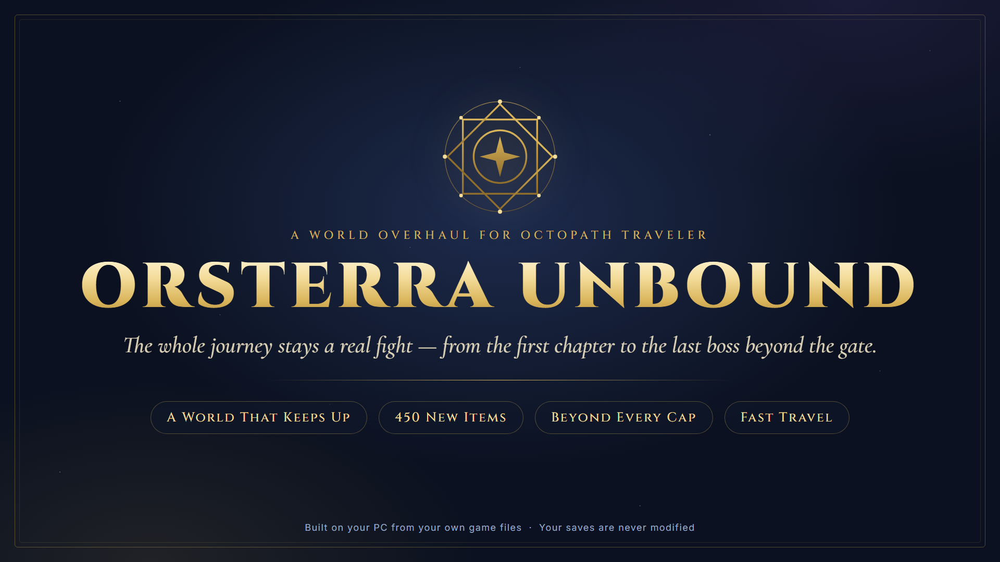
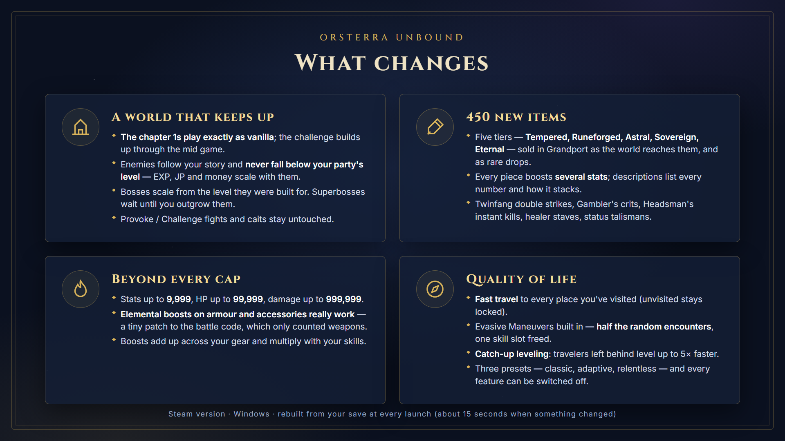
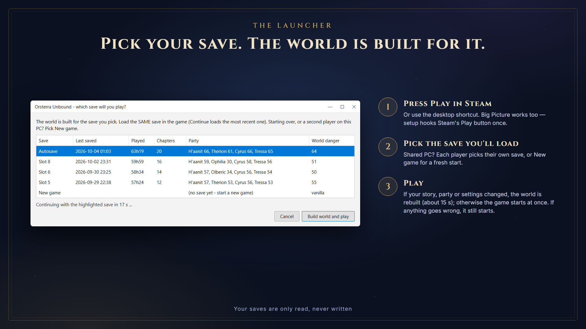
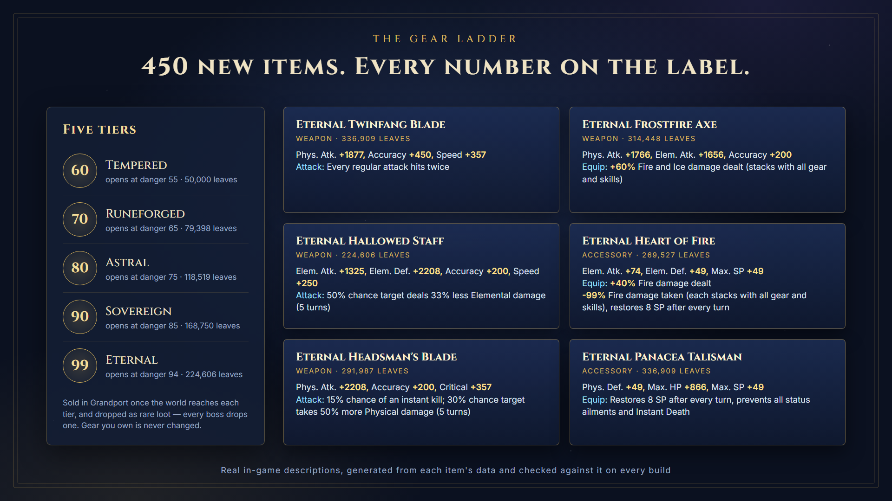
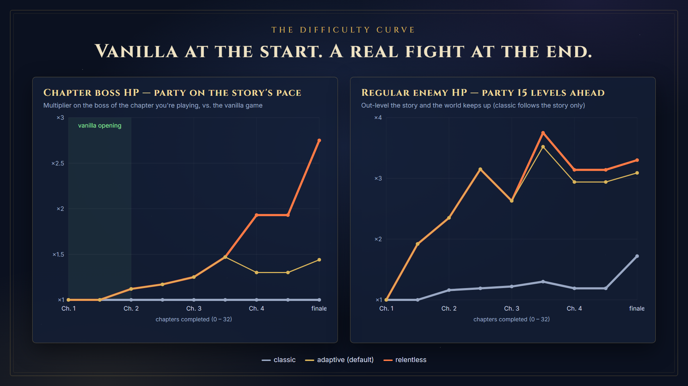

# Orsterra Unbound
### a world overhaul for Octopath Traveler



A difficulty, progression and gear overhaul for **Octopath Traveler (Steam, PC)** that keeps
the whole game interesting from the first chapter to the post-game. The world scales to how
far your story is and how strong your party is, bosses keep up when you out-level them, and
a new 450-item gear ladder carries you to level 99 and beyond the old 999 stat cap.

The mod is built **on your PC, from your own game files and your own save**, every time you
launch. No game data is redistributed, and your saves are never modified.

---



## Install

1. Download the latest release and extract the folder anywhere (for example
   `Documents\OctopathWorldOverhaul`). Keep the files together.
2. Run **`OctopathWorldOverhaul.exe`**. On first run a small setup window offers to:
   - make **Steam's Play button and Big Picture** run the overhaul first (Steam restarts once)
   - add a **desktop shortcut**
3. Pick the save you are going to play in the list that appears, and the game starts. Load
   **that same save** in the game.

That's it. From then on, launch the game the way you chose in setup; the world is rebuilt
automatically whenever your story, party level or settings change (about 15 seconds),
otherwise the game starts immediately.

**Requirements:** Windows, the Steam version of Octopath Traveler. Works alongside
*Better Descriptions*, *Side Stories Helper* and other text mods (their text is kept).



### Uninstall

Run `OctopathWorldOverhaul.exe --uninstall` (removes the mod file and the Steam hook), then
delete the folder and the desktop shortcut. Your saves were never touched.

---

## What it changes

### A world that keeps up
- **Enemies scale** to your progress. The baseline is the game's own recommended level for
  the chapters you're on, plus a small margin; if your party is stronger than that, the
  world matches your party instead. Areas you've outgrown are raised so backtracking still
  matters, and **EXP, JP and money scale with them**.
- **Bosses scale from the danger they were designed for.** A chapter 1 boss you tackle late
  in the game is a real fight; fought on time it's only a little tougher than vanilla.
  Superbosses only scale once the world passes them.
- **Never touched:** Provoke / Challenge NPC battles, caits (cait farming still works), and
  anything else that isn't a random encounter or a boss.
- **Area danger numbers** on the map follow the world.
- **H'aanit's captured beasts** get stronger along with the world, and **Tressa's Collect**
  talent finds bigger purses.

### A new gear ladder (from danger 55)
- **450 new items in five tiers** (Tempered, Runeforged, Astral, Sovereign, Eternal) sold in
  **Grandport** as the world reaches each tier, and as rare drops (bosses always drop one).
- Every piece boosts **several stats**, with accuracy on every weapon and SP on armour.
- **Weapon styles with on-hit effects**: Keen, Swift, Arcane, Brutal, Sage, Quicksilver,
  Battle, Ruinous — target takes +50% damage, deals −33% damage, loses speed, and more, at
  chances up to 50%. Plus **Twinfang** (every attack hits twice), **Gambler's** (crit or
  miss), **Headsman's** (instant kill), **Sundering**, **Hexing** status weapons, single and
  dual **elemental** weapons, **Hallowed** healer weapons (Elemental Defense = healing power)
  and the **War Staff** (a physical staff for Winnehild's Battle Cry).
- **Armour** in Heavy / Warded / Nimble variants, **Clearmind** and **Purity** immunity
  pieces, **Berserker Mail**.
- **Accessories**: stat charms, SP / HP regeneration pendants, EXP / JP tokens, status
  **talismans** (up to full immunity), elemental **wards**, **sigils** and **hearts**,
  Hunter's Lure.
- **Full descriptions** — every stat and effect is listed with its exact number, and how it
  stacks.
- **Elemental damage boosts work on armour and accessories.** The game only counted them on
  weapons; a 4-byte patch to its battle blueprint makes it count every equipped piece.
  Boosts of one element add up across all your gear (+30% staff + 20% sigil = +50%), and
  the total multiplies with support skills and buffs. Physical damage boosts add up across
  equipped weapons; elemental resistances add up across all gear, down to full immunity
  (as in vanilla).
- New consumables: **Invigorating Draught / Cask** (500 / 300 SP) and **Vital Draught /
  Cask** (50% / 35% max HP). From danger 68, ordinary enemy drops (and Therion's steals)
  become Revitalizing Jam, Olive of Life, and these.



### Quality of life
- **Fast travel to every location you have visited** (dungeons, caves, shrines — not just
  towns). Places you've never been stay locked.
- **Fewer random encounters**: Evasive Maneuvers is built in, so you get the support-skill
  slot back.
- **Catch-up leveling**: travelers more than 5 levels below your party level up about
  5× faster, so late recruits catch up without grinding.
- **Higher caps**: stats 9,999 (from 999), HP 99,999 (from 9,999), damage 999,999.

All of these can be switched off individually.

---

## Settings — `overhaul.ini`

Created next to the exe on first run. Every preset plays the **chapter 1s exactly as
vanilla** and builds up to its full strength through the chapter 2s and 3s; `relentless`
adds its extra step through the chapter 4s and the finale. Three presets (full strength):

| Preset | For | World | Boss / superboss HP |
|---|---|---|---|
| `classic` | vanilla feel | the story's own curve | ×1 / ×1, vanilla enemy levels |
| `adaptive` *(default)* | most players | a little above the story, never below your party | ×1.25 / ×1.25 |
| `relentless` | strong, over-levelled endgame parties | story +5, at least party level +4 | ×2 / ×4 |

`vanilla_start = false` under `[tuning]` applies the full strength from the start.

Every value can be overridden under `[tuning]`, and every system turned off under
`[features]`. See [docs/BALANCE.md](docs/BALANCE.md) for what each preset does at every
stage of the game.

---



## FAQ

**We share a PC / Steam account — does it work for two players?** Yes. The launcher asks
which save you're about to play and builds the world for that save. Load the same save in
the game (Continue loads whichever save is newest, so choose it from Load Game if needed).
Starting a brand-new game? Pick **New game** at the bottom of the list. Set
`save_choice = newest` in `overhaul.ini` to skip the question.

**Something went wrong — will the game still start?** Yes. If the overhaul can't be
rebuilt (game folder not found, a typo in `overhaul.ini`, the game still running...), you get
a message saying why and the game starts with the previous build. Details are in the `logs`
folder next to the exe. A rebuild takes about 15 seconds; if you click Play and nothing
seems to happen, give it a moment — the progress window may be on another monitor.

**Steam Deck / Linux / Game Pass?** Windows and the Steam version only. (The Game Pass
version stores its files differently.)

**Does the world change while I play?** The numbers are fixed for a session; the next
launch recalculates them from your save. Restart the game after a big story jump if you
want the world to catch up straight away.

**Other languages?** New item names and descriptions are in English in every language.

**Antivirus warning?** The exe is a packaged Python program (PyInstaller), which some
scanners flag by habit. The full source is in this repository, and you can run it from
source instead (see below).

**Can I get a fifth support-skill slot?** No — the slot count lives in the game's code, not
its data. (Tested: the game ignores a fifth skill and removes it on save.) The built-in
Evasive Maneuvers and the uncapped damage free up two slots instead.

---

## Running from source

```bash
pip install -r requirements-dev.txt     # only needed to build the exe
python src/launch_octopath.py           # same as the exe
python src/build_all.py                 # build a pak to the current folder, validate it
python dev/balance_report.py            # balance tables for every preset
```

Build the release exe with `powershell -File build_release.ps1`.

How it works, and why: [docs/DESIGN.md](docs/DESIGN.md).

---

*Not affiliated with Square Enix. Octopath Traveler is © Square Enix. This mod contains no
game files.* MIT licensed.
